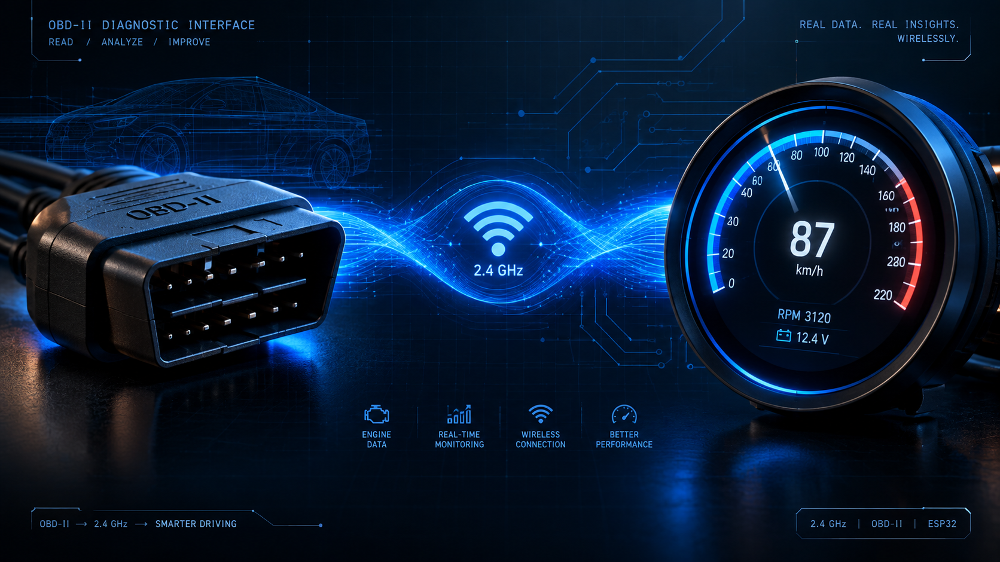

<div align="center">

# 🛰️ OpenGauge

### Moduláris járműtelemetria és kijelző OBD-II-n keresztül

*Kétegységes, vezeték nélküli műszerfal valós idejű járműdiagnosztikához.*

[](https://en.cppreference.com/)
[](https://docs.espressif.com/projects/esp-idf/en/latest/)
[](https://www.kicad.org/)
[](https://docs.espressif.com/projects/esp-idf/en/latest/esp32/api-reference/network/esp_now.html)
[](https://lvgl.io/)
[](#-licenc-és-felelősségkizárás)
[]()

</div>

---


*<p align="center">Illusztráció (koncepció): a jármű CAN-buszától a műszerfalra szerelhető, kerek kijelzőig.</p>*

---

## 📖 Áttekintés

Az **OpenGauge** egy BSc-szakdolgozati projekt: a jármű diagnosztikai adatainak beolvasását és megjelenítését két külön egységre bontja, amelyeket vezeték nélküli kapcsolat köt össze. Egyetlen, kijelzővel ellátott OBD-II dongle helyett két, a feladatára készült egység készül:

- **OBD-egység:** az OBD-II csatlakozóba dugott kis panel, amely a jármű CAN-buszáról olvassa a diagnosztikai adatokat, és a járműről kapja a tápfeszültségét.
- **Kijelzőegység:** a műszerfalra vagy a szellőzőrácsra szerelhető, kerek érintőkijelzős egység, amely vezeték nélkül kapja az adatokat, és animált műszereket jelenít meg. Akkumulátorról és USB-ről is működik.

A projekt része a két NYÁK megtervezése, legyártatása és üzembe helyezése, a beágyazott szoftver, a felhasználói felület és a 3D nyomtatott házak is.

A projekt nyíltan dokumentálja a tervezési hibákat is (hibanapló a `docs/` mappában), mert a felismert hibák és javításuk a fejlesztési folyamat része, és tanulságot adnak a következő verzióhoz.

---

## 🧭 Rendszerfelépítés

```
┌────────────────────────┐
│     JÁRMŰ (ECU-k)      │
│   CAN-H / CAN-L busz   │
└──────────┬─────────────┘
           │  OBD-II (J1962), ISO 15765-4
           ▼
┌────────────────────────────────────────────┐
│              OBD-EGYSÉG                    │
│  ESP32-C3-WROOM-02                         │
│  CAN-illesztő (SN65HVD23x), TWAI           │
│  Buck-áramkör (TPS54302): 12 V → 3,3 V     │
│  Bemeneti védelem (D8 SS34, D4 SMAJ24A)    │
└────────────────────┬───────────────────────┘
                     │  ESP-NOW (2,4 GHz, fix csatorna)
                     ▼
┌────────────────────────────────────────────────────┐
│              KIJELZŐEGYSÉG                         │
│  ESP32-S3-WROOM-1-N8R8 (8 MB PSRAM)                │
│  LVGL 9, QSPI kijelző-meghajtás                    │
│  Waveshare 1,85" kerek kijelző (ST77916, 360×360)  │
│  Érintő: CST816S (I²C)                             │
│  Táp: USB-C + 1S LiPo (TP4056, tápútválasztás)     │
└────────────────────────────────────────────────────┘
```

---

## ✨ Főbb jellemzők

**Hardver**
- Két egyedi, négyrétegű NYÁK (JLCPCB gyártás és szerelés).
- OBD-egység: szinkron buck, fordított polaritás elleni védelem, TVS, CAN-illesztő, ESP32-C3 modul, natív USB.
- Kijelzőegység: ESP32-S3 PSRAM-mal, USB-C és LiPo táp, töltő és tápútválasztás, 3,3 V-os LDO.

**Szoftver**
- OBD-II Mode 01 PID-ek ciklikus lekérdezése (fordulatszám, sebesség, hűtővíz, fojtószelep, akkumulátorfeszültség), a protokoll automatikus felismerésével (250/500 kbit/s, 11/29 bites azonosító).
- Többkeretes (ISO-TP) válaszok kezelése, VIN-lekérdezés.
- ESP-NOW telemetria egyszerű, verziózott bináris csomagokkal és sorszám-ellenőrzéssel.
- LVGL-alapú kerek műszerfal, folyamatos mutatómozgás a ritkább mérési adatok között.

**Opcionális bővítések**
- Alvó üzemmód, gyújtásra ébredéssel.
- BLE: médiavezérlés iOS-en (Apple Media Service) és Androidon (HID).
- Hibakódok **olvasása**.

---

## 📁 Tárolószerkezet

```
OpenGauge/
├── hardware/               # KiCad-projektek, gyártófájlok, BOM
├── firmware/
│   ├── components/         # közös komponensek (og_protocol, og_obd, og_common)
│   ├── obd_node/           # OBD-egység (ESP32-C3)
│   ├── display_node/       # kijelzőegység (ESP32-S3)
│   └── tools/
│       ├── ecu_sim/        # ESP32-S2: tesztadó és ECU-szimulátor
│       └── host_test/      # PC-s egységtesztek
├── mechanical/             # 3D nyomtatott házak (STEP/STL)
├── docs/
│   ├── fejlesztesi_naplo.xlsx   # hibák, változtatások, tervezési döntések
│   ├── 00_kepek/
│   ├── 01_projekt_bemutatas/
│   ├── 02_szoftver/
│   └── 03_hardver/
├── LICENSE
└── README.md
```

A lábkiosztások, alkatrészlisták és méretezések a `docs/03_hardver/` mappában vannak, egyetlen helyen, hogy ne legyen ellentmondás a dokumentumok között.

---

## 🛠️ Első lépések

**Előfeltételek**
- [ESP-IDF](https://docs.espressif.com/projects/esp-idf/en/latest/esp32/get-started/) 5.x (Windowson ESP-IDF Tools Installer vagy a VS Code Espressif-bővítmény)
- [KiCad](https://www.kicad.org/) a hardvertervek megnyitásához
- CMake és C++ fordító a PC-s tesztekhez

**PC-s tesztek (ESP-IDF nélkül)**
```bash
cd firmware
cmake -S tools/host_test -B build_host
cmake --build build_host
ctest --test-dir build_host --output-on-failure
```

**Fordítás és feltöltés**
```bash
# OBD-egység (ESP32-C3)
cd firmware/obd_node
idf.py set-target esp32c3
idf.py -p COM5 flash monitor

# Kijelzőegység (ESP32-S3)
cd ../display_node
idf.py set-target esp32s3
idf.py -p COM7 flash monitor
```
Két panel naplója egyszerre is figyelhető: mindkettő külön soros porton jelenik meg, külön terminálokból.

---

## 📜 Licenc és felelősségkizárás

A projekt **MIT licenc** alatt áll, a részletek a [`LICENSE`](LICENSE) fájlban találhatók.

> ⚠️ **Gépjárművi biztonsági figyelmeztetés**
> Az OpenGauge **csak olvasó** diagnosztikai eszköz. Kizárólag szabványos OBD-II diagnosztikai kéréseket küld (olvasó szolgáltatások: Mode 01 és Mode 09, tervezetten Mode 03), a válaszokat megjeleníti, de **nem ír, nem töröl és nem módosít** semmit a járműben: nem törli a hibakódokat, nem küld vezérlő- vagy beavatkozó keretet. Oktatási és diagnosztikai megjelenítési célra készült, **nem** tanúsított gépjárművi biztonsági, kibocsátás-ellenőrző vagy vezérlőeszköz. A használat saját felelősségre történik, a szerzők nem vállalnak felelősséget a jármű meghibásodásáért, elektromos károkért vagy balesetekért. Járműre csatlakoztatás előtt győződj meg a megfelelő védelemről és az OBD-II csatlakozó szabályos használatáról.

---

<div align="center">

**OpenGauge**: BSc-szakdolgozati projekt.

</div>
